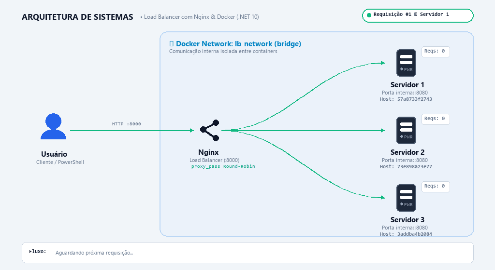

# AppLoadBalancer - Load Balancer com Nginx e Docker

Este projeto demonstra como criar um Load Balancer utilizando o **Nginx** e 3 instâncias de uma API **ASP.NET Core (.NET 10)** rodando em containers Docker.

<p align="center">
  
</p>

---

## Estrutura de Arquivos

- `AppLoadBalancer.Server1/Dockerfile`: Dockerfile multi-stage da API (.NET 10).
- `nginx/nginx.conf`: Configuração do Nginx com `upstream` configurado em Round-Robin para os 3 servidores.
- `docker-compose.yml`: Orquestração dos 4 containers (1 Nginx + 3 réplicas da API).

---

## 🧪 Como rodar localmente com Docker Compose

Como as imagens já estão publicadas no Docker Hub (`danmcorrea/apploadbalancer-server:latest`), basta ter o Docker instalado, clonar este repositório e executar na pasta do docker-compose:

```bash
docker compose up -d
```

> O Docker fará o download automático das imagens necessárias e iniciará os 3 servidores da API e o balanceador Nginx.

---

## 🔍 Como Testar o Load Balancer

Faça requisições na porta configurada do Nginx (`http://localhost:8000/`):

### Via PowerShell:
```powershell
1..6 | ForEach-Object {
    Invoke-RestMethod -Uri "http://localhost:8000/" -Method Get
}
```

### Resultado esperado (Round-Robin):
```text
Requisição Servidor 1 (Container Host: 57a8733f2743)
Requisição Servidor 2 (Container Host: 73e898a23e77)
Requisição Servidor 3 (Container Host: 3addba4b2084)
Requisição Servidor 1 (Container Host: 57a8733f2743)
Requisição Servidor 2 (Container Host: 73e898a23e77)
Requisição Servidor 3 (Container Host: 3addba4b2084)
```

Para parar os containers:
```bash
docker compose down
```

---

## 🛠️ Para Desenvolvedores: Como gerar e subir uma nova imagem

Caso você queira alterar o código da API e publicar a sua própria imagem no Docker Hub:

### 1. Fazer login no Docker Hub
```bash
docker login
```

### 2. Gerar a imagem com a sua tag
Substitua `<seu-usuario>` pelo seu nome de usuário no Docker Hub:
```bash
docker build -t <seu-usuario>/apploadbalancer-server:latest -f AppLoadBalancer.Server1/Dockerfile AppLoadBalancer.Server1
```

### 3. Enviar (Push) para o Docker Hub
```bash
docker push <seu-usuario>/apploadbalancer-server:latest
```
